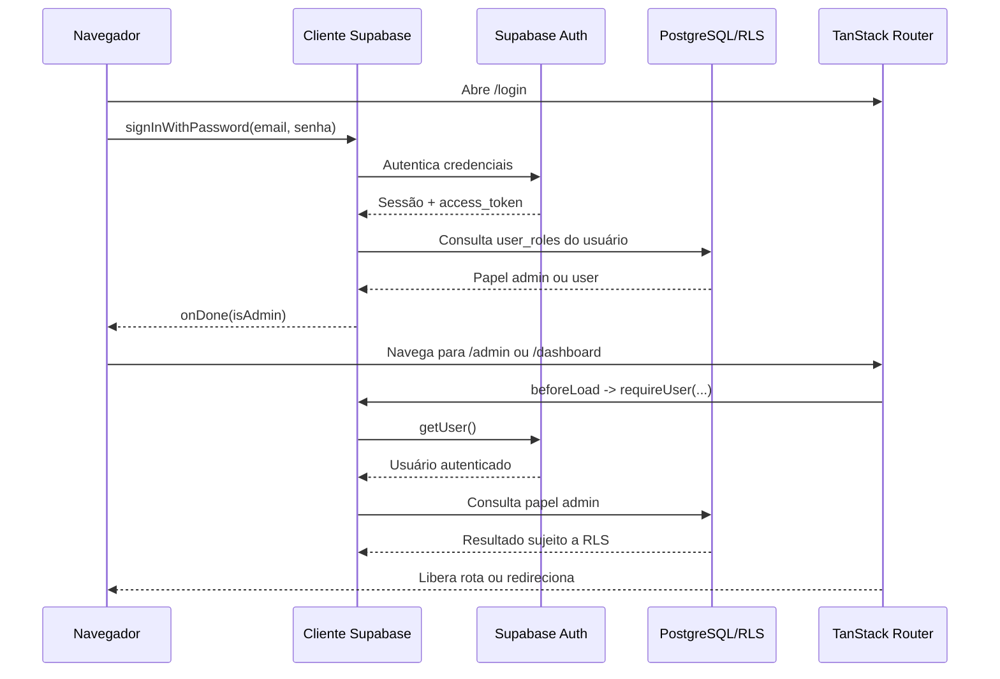

# SDD: Regar — Documentação Técnica Geral

## 1. Visão Geral do Sistema

**Regar** é uma aplicação web responsiva de autocuidado diário baseada na metáfora de um jardim. O usuário responde a um questionário diário, recebe ou perde gotas d'água, acompanha seu saldo e troca gotas por recompensas. O administrador gerencia perguntas, recompensas, saldos e entregas.

O sistema é uma aplicação frontend React executada com TanStack Start/Vite e integrada diretamente ao Supabase. A autenticação é feita pelo Supabase Auth; os dados de negócio ficam no schema `public` do PostgreSQL. As operações que alteram saldo ou concedem uma submissão são encapsuladas em funções PostgreSQL com `SECURITY DEFINER`.

Principais perfis:

- **Usuário comum:** acessa jardim, rega diária, saldo, recompensas e própria colheita.
- **Administrador:** acessa o painel administrativo, visualiza os usuários comuns, ajusta gotas, administra perguntas e recompensas e processa resgates.

Fontes principais da implementação: [rotas](../src/routes), [regras de sessão](../src/lib/garden.ts), [migrations](../drizzle/migrations/0000_migration.sql) e [tipos Supabase](../src/integrations/supabase/types.ts).

## 2. Stack Utilizada

### Frontend e execução

- **React 19** e **React DOM**.
- **TypeScript** com modo estrito habilitado em [tsconfig.json](../tsconfig.json).
- **TanStack Router** para roteamento tipado e guards em `beforeLoad`.
- **TanStack Start** para a integração de aplicação/server functions.
- **Vite** como bundler e servidor de desenvolvimento.
- **TanStack Query** para cache, consultas, mutations e invalidação de dados.
- **Tailwind CSS v4** com `tw-animate-css`.
- **Radix UI** e **Lucide React** para componentes e ícones.
- **Vitest**, Testing Library e JSDOM para testes.
- **ESLint** e **Prettier** para qualidade e formatação.

### Backend e persistência

- **Supabase Auth** para autenticação por e-mail e senha.
- **Supabase PostgreSQL** para persistência, RLS, triggers e RPCs.
- **Supabase Realtime** para atualização de perfis e resgates.
- **Drizzle Kit** para configuração e versionamento de migrations SQL. O arquivo de schema TypeScript do Drizzle está atualmente vazio; a definição efetiva do banco está nas migrations SQL.

### Identidade visual

- Cores definidas em [src/styles.css](../src/styles.css): `forest`, `leaf`, `olive`, `cream` e `tulip`.
- Títulos com **Cormorant Garamond** e textos funcionais com **Jost**, carregadas no root da aplicação.
- Idioma da interface: `pt-BR`.

## 3. Modelo de Dados Supabase

Além das tabelas abaixo, o Supabase Auth mantém a tabela gerenciada `auth.users`, que é a origem da identidade do usuário. A criação de um usuário dispara `public.handle_new_user()`.

### 3.1 Enumeração e funções auxiliares

#### `public.app_role`

Enumeração de papéis permitidos:

- `admin`
- `user`

#### `public.has_role(_user_id uuid, _role app_role) -> boolean`

Função `STABLE SECURITY DEFINER` que verifica a existência do papel em `user_roles`. É usada nas policies RLS e nas funções administrativas.

#### `public.handle_new_user()`

Trigger executado após a inserção em `auth.users`:

1. Cria o perfil em `profiles` usando `display_name` do metadata ou a parte do e-mail anterior ao `@`.
2. Para o e-mail `pedroandre1508@gmail.com`, cria o papel `admin` e define o nome como `Pedro`.
3. Para os demais usuários, cria o papel `user`.
4. Usa `ON CONFLICT DO NOTHING`, portanto pode ser reaplicada com segurança.

A migration `0001_migration.sql` também promove para `admin` um usuário já existente com esse e-mail.

### 3.2 Tabelas de identidade e saldo

#### `public.profiles`

Perfil e saldo atual do usuário.

| Campo          | Tipo          | Regra                                                |
| -------------- | ------------- | ---------------------------------------------------- |
| `id`           | `uuid`        | PK e FK para `auth.users(id)`, com cascade no delete |
| `display_name` | `text`        | Obrigatório, padrão vazio                            |
| `drops`        | `integer`     | Obrigatório, padrão `0`                              |
| `created_at`   | `timestamptz` | Obrigatório, padrão `now()`                          |

O saldo nunca é alterado por uma operação comum do cliente. A atualização ocorre pelas RPCs `submit_daily`, `redeem_reward` e `admin_adjust_drops`.

#### `public.user_roles`

Relaciona usuários aos seus papéis.

| Campo     | Tipo       | Regra                                 |
| --------- | ---------- | ------------------------------------- |
| `id`      | `uuid`     | PK, padrão `gen_random_uuid()`        |
| `user_id` | `uuid`     | FK para `auth.users(id)`, obrigatório |
| `role`    | `app_role` | Obrigatório                           |

Há unicidade composta em `(user_id, role)`, impedindo duplicidade do mesmo papel para um usuário.

### 3.3 Questionário diário

#### `public.questions`

Perguntas administráveis do questionário.

| Campo        | Tipo          | Regra                          |
| ------------ | ------------- | ------------------------------ |
| `id`         | `uuid`        | PK                             |
| `text`       | `text`        | Obrigatório                    |
| `active`     | `boolean`     | Padrão `true`                  |
| `position`   | `integer`     | Padrão `0`, controla ordenação |
| `created_at` | `timestamptz` | Padrão `now()`                 |

#### `public.question_options`

Alternativas de cada pergunta.

| Campo         | Tipo      | Regra                                           |
| ------------- | --------- | ----------------------------------------------- |
| `id`          | `uuid`    | PK                                              |
| `question_id` | `uuid`    | FK para `questions(id)` com cascade no delete   |
| `label`       | `text`    | Obrigatório                                     |
| `points`      | `integer` | Padrão `0`, pode ser positivo, zero ou negativo |
| `position`    | `integer` | Padrão `0`                                      |

A tela administrativa exige pelo menos duas alternativas preenchidas. A tela de rega exige uma alternativa para cada pergunta ativa carregada.

### 3.4 Recompensas e resgates

#### `public.rewards`

Catálogo de recompensas.

| Campo         | Tipo          | Regra                        |
| ------------- | ------------- | ---------------------------- |
| `id`          | `uuid`        | PK                           |
| `name`        | `text`        | Obrigatório                  |
| `description` | `text`        | Obrigatório, padrão vazio    |
| `cost`        | `integer`     | Obrigatório e maior que zero |
| `emoji`       | `text`        | Obrigatório, padrão `🌷`     |
| `active`      | `boolean`     | Padrão `true`                |
| `created_at`  | `timestamptz` | Padrão `now()`               |

#### `public.redemptions`

Histórico de recompensas resgatadas. O nome, emoji e custo são copiados no momento do resgate para preservar o histórico mesmo que o catálogo seja alterado ou removido.

| Campo          | Tipo          | Regra                                            |
| -------------- | ------------- | ------------------------------------------------ |
| `id`           | `uuid`        | PK                                               |
| `user_id`      | `uuid`        | Usuário que resgatou                             |
| `reward_id`    | `uuid`        | FK opcional para `rewards`, `ON DELETE SET NULL` |
| `reward_name`  | `text`        | Snapshot do nome                                 |
| `reward_emoji` | `text`        | Snapshot do ícone                                |
| `cost`         | `integer`     | Snapshot do custo                                |
| `status`       | `text`        | `pending` ou `delivered`, padrão `pending`       |
| `created_at`   | `timestamptz` | Padrão `now()`                                   |
| `delivered_at` | `timestamptz` | Preenchido ao marcar entrega                     |

### 3.5 Submissões diárias

#### `public.daily_submissions`

Registro de uma rega concluída por usuário e dia.

| Campo        | Tipo          | Regra                                |
| ------------ | ------------- | ------------------------------------ |
| `id`         | `uuid`        | PK                                   |
| `user_id`    | `uuid`        | Usuário da submissão                 |
| `day`        | `date`        | Dia do ciclo em horário de São Paulo |
| `total`      | `integer`     | Pontuação final da submissão         |
| `created_at` | `timestamptz` | Padrão `now()`                       |

A chave única `(user_id, day)` garante uma submissão por usuário por dia.

## 4. Funções de Banco e Operações Críticas

As funções são `SECURITY DEFINER`, têm `search_path = public`, não são executáveis por `public` ou `anon` e são concedidas apenas a `authenticated`.

### `submit_daily(_option_ids uuid[]) -> integer`

1. Obtém o usuário atual com `auth.uid()`.
2. Recusa chamadas sem autenticação.
3. Converte o horário atual para `America/Sao_Paulo`.
4. Recusa chamadas antes das 08:00.
5. Recusa se já houver registro para `(user_id, day)`.
6. Soma as opções selecionadas somente de perguntas ativas e usa no máximo uma opção por pergunta.
7. Insere a submissão.
8. Atualiza `profiles.drops` com `greatest(0, drops + total)`, evitando saldo negativo.
9. Retorna o total calculado.

### `redeem_reward(_reward_id uuid) -> void`

1. Obtém o usuário autenticado.
2. Busca somente recompensa ativa.
3. Bloqueia o perfil para leitura do saldo durante a operação (`FOR UPDATE`).
4. Recusa saldo insuficiente.
5. Desconta o custo.
6. Insere o resgate com snapshot do nome, emoji e custo.

### `admin_adjust_drops(_user_id uuid, _delta integer) -> integer`

1. Verifica se o chamador tem papel `admin`.
2. Soma o delta ao saldo do usuário alvo.
3. Impede resultado abaixo de zero.
4. Retorna o novo saldo.

### `has_role(_user_id uuid, _role app_role) -> boolean`

Consulta usada para aplicar autorização de administrador nas policies e na RPC de ajuste de saldo.

## 5. Roteamento da Aplicação

A árvore tipada em [src/routeTree.gen.ts](../src/routeTree.gen.ts) registra as seguintes rotas:

| Rota         | Implementação                                | Acesso                        | Responsabilidade                                                           |
| ------------ | -------------------------------------------- | ----------------------------- | -------------------------------------------------------------------------- |
| `/`          | [index.tsx](../src/routes/index.tsx)         | Público                       | Redireciona sempre para `/login`.                                          |
| `/login`     | [login.tsx](../src/routes/login.tsx)         | Público                       | Login de usuário e modal de login administrativo. SSR desabilitado.        |
| `/dashboard` | [dashboard.tsx](../src/routes/dashboard.tsx) | Usuário autenticado não-admin | Jardim, saldo, chamada diária, recompensas e inventário. SSR desabilitado. |
| `/regar`     | [regar.tsx](../src/routes/regar.tsx)         | Usuário autenticado não-admin | Questionário diário e submissão da rega. SSR desabilitado.                 |
| `/admin`     | [admin.tsx](../src/routes/admin.tsx)         | Usuário autenticado admin     | Saldos, perguntas, recompensas e resgates. SSR desabilitado.               |

A rota raiz possui também componentes globais de 404 e erro em [__root.tsx](../src/routes/__root.tsx).

## 6. Regras de Segurança de Rotas

### Guard de sessão

`requireUser(admin)` em [src/lib/garden.ts](../src/lib/garden.ts) chama `supabase.auth.getUser()` no navegador:

- Sem usuário: redireciona para `/login`.
- Com usuário e `admin = true`, mas sem papel `admin`: redireciona para `/dashboard`.
- Com usuário e `admin = false`, mas com papel `admin`: redireciona para `/admin`.
- Caso contrário, retorna `{ user, isAdmin }` para o contexto da rota.

Consequentemente, o administrador não usa as telas de usuário e o usuário comum não acessa o painel administrativo.

### Login

- O formulário comum aceita e-mail e senha e, após autenticação, consulta `user_roles`.
- Se a conta autenticada for admin, a navegação vai para `/admin`; caso contrário, vai para `/dashboard`.
- O modal “Acesso ADM” exige autenticação e valida que a conta possui papel `admin`. Se não possuir, a sessão é encerrada e o acesso é negado.
- A sessão persiste no storage configurado pelo cliente Supabase, com renovação automática de token.

### Proteção de dados

As rotas não são a única camada de segurança. O PostgreSQL aplica RLS mesmo que uma chamada seja feita fora da interface:

- `profiles`: usuário lê o próprio perfil; admin lê perfis.
- `user_roles`: usuário lê os próprios papéis; admin lê papéis.
- `questions`: usuário lê perguntas ativas; admin possui acesso administrativo completo.
- `question_options`: usuários autenticados podem ler opções; alterações são administrativas.
- `rewards`: usuário lê recompensas ativas; admin possui acesso administrativo completo.
- `redemptions`: usuário lê os próprios resgates; admin lê e atualiza todos.
- `daily_submissions`: usuário lê as próprias submissões; admin lê todas.

As políticas administrativas usam `has_role(auth.uid(), 'admin')`. Alterações de saldo, submissão diária e resgate devem ocorrer pelas RPCs correspondentes, e não por mutações diretas no cliente.

## 7. Fluxo Geral de Autenticação



Detalhes da sessão:

1. [auth-attacher.ts](../src/integrations/supabase/auth-attacher.ts) obtém o `access_token` atual e o envia no header `Authorization: Bearer ...` para server functions.
2. [auth-middleware.ts](../src/integrations/supabase/auth-middleware.ts) valida o Bearer token no lado servidor quando uma server function usa o middleware de autenticação.
3. [start.ts](../src/start.ts) registra o attacher de autenticação como middleware global de funções e registra proteção CSRF para server functions.
4. O cliente Supabase mantém a sessão, renova tokens automaticamente e usa o storage de preview quando necessário.
5. [__root.tsx](../src/routes/__root.tsx) observa `onAuthStateChange`; em logout limpa o cache do React Query, e nos demais eventos invalida consultas e invalida o router.
6. O logout em `GardenNav` cancela e limpa o cache, chama `supabase.auth.signOut()` e redireciona para `/login`.

## 8. Fluxos Funcionais Principais

### 8.1 Rega diária

1. Usuário autenticado acessa `/dashboard` ou `/regar`.
2. O frontend calcula o dia e a hora em `America/Sao_Paulo`.
3. Antes das 08:00, exibe que a flor está descansando.
4. Se já existe uma submissão no dia, exibe que o jardim já foi regado.
5. Caso contrário, carrega perguntas `active = true` e suas opções ordenadas.
6. O botão fica habilitado somente quando todas as perguntas carregadas possuem resposta.
7. O cliente chama `submit_daily` com os IDs das opções.
8. O banco valida novamente horário, autenticidade, unicidade, perguntas ativas e pontuação, atualiza o saldo e retorna o total.
9. A interface mostra o resumo e invalida as consultas de perfil e submissão.

### 8.2 Resgate de recompensa

1. O dashboard carrega somente recompensas ativas.
2. O botão é desabilitado quando o saldo visual é menor que o custo.
3. O cliente chama `redeem_reward`.
4. O banco valida novamente que a recompensa está ativa e que há saldo suficiente, trava o perfil, debita as gotas e cria o resgate.
5. O dashboard atualiza saldo e inventário via React Query e Realtime.

### 8.3 Administração

O administrador acessa `/admin` e pode:

- Visualizar perfis que não têm papel admin e seus saldos.
- Ajustar gotas por delta positivo ou negativo usando `admin_adjust_drops`.
- Criar perguntas com alternativas e pontuações.
- Ativar, inativar ou excluir perguntas.
- Criar recompensas com emoji, nome, descrição e custo.
- Ativar, inativar ou excluir recompensas.
- Visualizar todos os resgates e marcar resgates pendentes como `delivered`, preenchendo `delivered_at`.

## 9. Atualização de Dados e Estado da Interface

- O React Query mantém consultas separadas para perfil, submissão do dia, perguntas, recompensas e inventário.
- Após mutations, as queries afetadas são invalidadas para refletir o estado do banco.
- O dashboard assina Realtime para alterações no próprio `profiles` e `redemptions`.
- O painel administrativo assina Realtime para alterações em `profiles` e `redemptions`.
- A publicação realtime inclui `profiles` e `redemptions`; perguntas, opções e recompensas são atualizadas por invalidação após ações administrativas.

## 10. Limites e Observações da Implementação Atual

- O [schema.ts](../drizzle/schema.ts) do Drizzle está vazio e marcado como auto-generated; para entender o banco atual, as migrations SQL e os tipos Supabase são as fontes de verdade.
- O frontend usa somente a chave publicável do Supabase e as policies RLS/RPCs do banco. Se uma camada server-side com service role for adicionada futuramente, ela deverá permanecer restrita ao servidor e nunca ser empacotada para o navegador.
- A proteção de rota ocorre no navegador (`ssr: false`) porque a sessão utiliza storage do browser. A segurança definitiva dos dados permanece nas policies RLS e nas RPCs.
- O código define grants de escrita para tabelas administrativas, mas as policies `admin questions` e `admin rewards` restringem essas operações ao papel admin. Para `profiles` e `daily_submissions`, não há policy de escrita direta para usuários autenticados.
- A atualização de status de resgate é uma atualização direta protegida pela policy de admin; o frontend preenche `delivered_at` com o horário ISO do navegador.
- Há somente um teste automatizado de roteamento, em [app-routing.test.tsx](../src/test/app-routing.test.tsx). Os fluxos de autenticação, RLS, RPCs e integração com o Supabase não possuem testes automatizados neste repositório.

## 11. Comandos de Desenvolvimento e Validação

```sh
npm install
npm run dev
npm run build
npm run lint
npm run test
```

Variáveis usadas pelo cliente e pelo ambiente servidor incluem `SUPABASE_URL`, `SUPABASE_PUBLISHABLE_KEY`, `VITE_SUPABASE_URL`, `VITE_SUPABASE_PUBLISHABLE_KEY` e, para operações administrativas de servidor, `SUPABASE_SERVICE_ROLE_KEY`. A chave de service role não deve ser exposta ao navegador.
